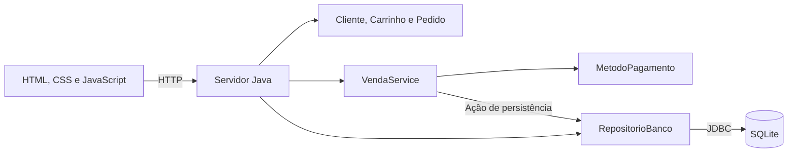

# IronStore

Loja de suplementos desenvolvida para a disciplina de **Programação Orientada a Objetos** do curso de Análise e Desenvolvimento de Sistemas. O projeto demonstra o ciclo de uma venda, da busca no catálogo à emissão do recibo, com regras de negócio em Java e persistência em SQLite.

## Requisitos atendidos

| Requisito | Implementação |
|---|---|
| Backend em Java | O servidor HTTP recebe as requisições do navegador. O Java valida os dados e o estoque, calcula os descontos e coordena as vendas. |
| Pix | Geração de QR Code e código Pix Copia e Cola com o total calculado para a compra ou para a mensalidade VIP. |
| Cartão de crédito | Seleção de cartão cadastrado e pagamento em até 12 parcelas sem juros. |
| Cartão de débito | Seleção de cartão cadastrado e pagamento à vista. |

Os pagamentos são de demonstração e processados localmente. Use dados fictícios durante os ensaios e a apresentação.

## Evolução do projeto

1. **Modelagem em Java.** O núcleo começou com as classes de produto, cliente, carrinho, pedido e recibo. Cada classe representa dados e comportamentos do domínio da loja.
2. **Integração com o navegador.** O servidor HTTP em Java passou a servir HTML, CSS e JavaScript e a receber as ações do usuário. O catálogo foi ampliado para nove produtos, com foto, busca, filtro por categoria e ficha de detalhes.
3. **Checkout e persistência.** O fluxo passou a coletar dados do cliente, endereço de entrega e forma de pagamento em três etapas. O SQLite passou a guardar vendas, estoque e cartões cadastrados. O Pix ganhou QR Code gerado pelo backend com ZXing.
4. **Clube VIP.** O cadastro e a confirmação da mensalidade passaram a determinar a elegibilidade ao desconto. A identificação e o e-mail ligam a assinatura ao cliente do checkout.
5. **Entrega executável.** A aplicação foi empacotada em um JAR compatível com Java 17, com bibliotecas locais, scripts de execução e testes automatizados.

## Arquitetura



| Componente | Responsabilidade |
|---|---|
| [Main.java](src/main/java/br/com/sistema/vendas/Main.java) | Lê as propriedades `porta` e `dados` e inicializa o servidor. |
| [Servidor.java](src/main/java/br/com/sistema/vendas/web/Servidor.java) | Serve a interface, recebe formulários HTTP, consulta assinaturas e chama as operações da aplicação. |
| [model](src/main/java/br/com/sistema/vendas/model) | Contém os objetos de domínio e regras de desconto, estoque e estado do pedido. |
| [VendaService.java](src/main/java/br/com/sistema/vendas/service/VendaService.java) | Coordena validação do estoque, pagamento, geração do recibo e fechamento da venda. |
| [payment](src/main/java/br/com/sistema/vendas/payment) | Implementa Pix, crédito e débito e gera os QR Codes com ZXing. |
| [storage](src/main/java/br/com/sistema/vendas/storage) | Abre conexões JDBC, executa SQL e persiste os dados da loja. |
| [public](src/main/resources/public) | Contém o HTML, os estilos CSS, as fotos e o JavaScript que consome a API e atualiza a interface. |

## Como uma compra é concluída

1. O usuário adiciona um produto. O navegador envia `POST /api/carrinho/adicionar`. O Java verifica a disponibilidade e atualiza o carrinho.
2. No checkout, a interface solicita os dados do cliente e o endereço. O servidor consulta o status da assinatura e usa `ClienteVip` ou `ClientePadrao` conforme a vigência do benefício.
3. O sistema calcula o **subtotal** pela soma dos itens e o **total** pela diferença entre subtotal e desconto. O Java usa `BigDecimal` e arredonda os valores monetários para duas casas decimais.
4. Para Pix, a API gera uma cobrança e aguarda a confirmação da referência. Para crédito ou débito, a API usa o cartão selecionado e valida o parcelamento ou o saldo simulado, conforme a modalidade.
5. `VendaService` verifica o estoque novamente, cria o pedido e chama `processarPagamento` por meio da interface `MetodoPagamento`. O fluxo de sucesso passa por `ABERTO → AGUARDANDO_PAGAMENTO → PAGO → CONCLUIDO`.
6. O repositório grava a venda, seus itens, endereço, pagamento e atualização de estoque em uma transação. Após a gravação, o serviço limpa o carrinho e disponibiliza o recibo. Quando o fechamento falha, o serviço restaura o estoque em memória e estorna o saldo ou limite simulado quando aplicável.

### Regras do Clube VIP

A mensalidade custa **R$ 19,90** e é confirmada por Pix de demonstração. O cadastro começa com mensalidade pendente. A confirmação ativa um mês de benefício. A renovação é manual. Uma renovação antes do vencimento estende a validade atual por um mês.

| Cliente | Desconto sobre o subtotal |
|---|---|
| Padrão | 0% abaixo de R$ 500,00 e 5% a partir de R$ 500,00. |
| VIP ativo | 10% até R$ 700,00, inclusive, e 15% a partir de R$ 700,01. |

Uma creatina de R$ 89,90 custa **R$ 80,91** com o benefício ativo. Ao consultar ou ativar a assinatura, abra o checkout na mesma aba para reaproveitar o cadastro. O Java verifica a identificação, o e-mail e a validade da mensalidade ao calcular o desconto.

### Rotas HTTP para acompanhar o código

| Método e rota | Operação |
|---|---|
| `GET /api/estado` | Retorna catálogo, carrinho, valores e recibos em JSON. |
| `POST /api/carrinho/quantidade` | Altera a quantidade de um item. |
| `POST /api/vip/cadastrar` e `POST /api/vip/status` | Registram e consultam a assinatura. |
| `POST /api/vip/pix/gerar` e `POST /api/vip/pix/confirmar` | Geram e confirmam a cobrança da mensalidade. |
| `POST /api/pix/gerar` e `POST /api/pix/confirmar` | Geram e confirmam a cobrança de uma compra. |
| `POST /api/cartoes/cadastrar` | Cadastra um cartão para uso no checkout. |
| `POST /api/venda/finalizar` | Finaliza uma compra por crédito ou débito. |

## POO aplicada

| Conceito | Exemplo no código |
|---|---|
| Encapsulamento | `Produto` protege seus atributos e controla a mudança de estoque por métodos como `debitarEstoque` e `reporEstoque`. |
| Abstração e herança | A classe abstrata `Cliente` concentra os dados comuns. `ClientePadrao` e `ClienteVip` estendem a classe e definem o percentual. |
| Interface e polimorfismo | `VendaService` recebe `MetodoPagamento`. `PagamentoPix`, `PagamentoCartao` e `PagamentoDebito` executam o mesmo contrato com comportamentos específicos. |
| Composição | `CarrinhoDeCompras` reúne objetos `ItemPedido`, que relacionam produto, quantidade e preço unitário. |
| Sobrecarga | As versões de `finalizarCompra` aceitam combinações diferentes de argumentos, incluindo endereço e ação de persistência. |
| Controle de estado | O enum `EstadoPedido` define as transições permitidas. `TransicaoEstadoInvalidaException` representa uma tentativa fora desse fluxo. |

## Banco de dados

O [esquema SQLite](banco/schema.sql) define chaves e relacionamentos. `ConexaoBanco` abre a conexão JDBC e `RepositorioBanco` usa instruções SQL parametrizadas. Valores monetários são gravados como centavos inteiros. Uma venda relaciona o cliente a itens, endereço e pagamento por chaves estrangeiras. O repositório usa `commit` para confirmar a gravação ou `rollback` em caso de erro.

- **Catálogo e vendas.** `produtos`, `clientes`, `vendas`, `itens_venda`, `enderecos_entrega` e `pagamentos`.
- **Cartões e assinaturas.** `cartoes`, `assinaturas_vip` e `mensalidades_vip`. O banco guarda titular, validade e os quatro últimos dígitos do número do cartão.
- **Estado em memória.** O carrinho e os Pix pendentes duram enquanto o servidor estiver aberto. O servidor atende na máquina local, com um carrinho compartilhado entre suas abas.

## Executar em outro computador

1. No GitHub, abra **Code → Download ZIP** e extraia o arquivo inteiro. Quem usa Git pode executar `git clone https://github.com/LeiteBayer/Loja.suplementos.git`.
2. Abra o terminal na pasta que contém `loja-suplementos.jar` e `lib`. No Windows, abra a pasta no Explorador, digite `powershell` na barra de endereço e pressione Enter.
3. Execute `java -version` e confirme que a máquina tem Java 17 ou superior. Mantenha a pasta `lib` ao lado do JAR.
4. Inicie a loja e mantenha o terminal aberto.

```powershell
java -jar loja-suplementos.jar
```

Após a mensagem **Loja iniciada**, abra a loja no navegador da máquina que executa o servidor. [localhost:8080](http://localhost:8080)

O banco padrão é `dados/loja.db`. Para a apresentação, escolha um nome de banco novo. Na primeira execução, o Java cria o arquivo com os nove produtos e o estoque inicial. Cadastros e recibos são gerados conforme vocês avançam na demonstração.

```powershell
java "-Dporta=8081" "-Ddados=dados/apresentacao-ao-vivo.db" -jar loja-suplementos.jar
```

Com esse comando, abra [localhost:8081](http://localhost:8081). Use `dados/ensaio.db` para ensaiar em um histórico separado. Pressione **Ctrl+C** no terminal para encerrar o servidor.

## Compilar e testar

Para compilar a partir do código-fonte, use **JDK 17 ou superior**. No Windows, a partir da raiz do projeto, execute `.\compilar.bat` para gerar o JAR ou `.\testar.bat` para compilar e rodar as verificações. Em Linux ou macOS, use `sh compilar.sh` e `sh testar.sh`.

- [Testes.java](src/test/java/br/com/sistema/vendas/Testes.java) verifica o domínio e a API HTTP. Inclui os três meios de pagamento, leitura do QR Code, ativação e expiração do VIP e valores de R$ 700,00 e R$ 700,01.
- [TesteBanco.java](src/test/java/br/com/sistema/vendas/TesteBanco.java) verifica persistência, relacionamentos e rollback em SQLite. Os testes usam arquivos de banco temporários.

## Roteiro da apresentação

1. Busque uma creatina e abra a ficha do produto para mostrar o catálogo.
2. Cadastre um cliente VIP com dados fictícios. Mostre o status pendente, confirme a mensalidade e confira o vencimento.
3. Adicione a creatina ao carrinho. Abra o checkout na mesma aba e mostre de onde vem o preço de **R$ 80,91**. Preencha a entrega, conclua por Pix e abra o recibo.
4. Em duas novas compras, demonstre crédito parcelado e débito à vista. Use o cartão de teste `4111 1111 1111 1111` com titular fictício e validade futura.
5. No código, mostre `ClienteVip` para explicar herança, `MetodoPagamento` para demonstrar polimorfismo e `RepositorioBanco` para explicar a transação da venda.

Para estudar com o grupo, use o roteiro com exemplos de classes e o guia de execução. [Guia da apresentação](GUIA_APRESENTACAO.md) · [Instruções de execução e consulta](LEIA_PRIMEIRO.md)
